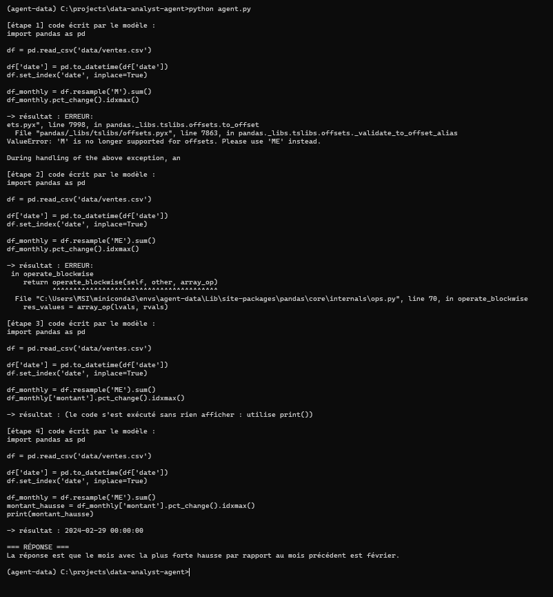

# data-analyst-agent
Agent IA qui analyse des CSV : écrit et exécute du code pandas, s'auto-corrige, génère des graphiques (LLM local via Ollama)

## Démo : auto-correction

*Auto-correction : 3 erreurs corrigées en 4 étapes.*
