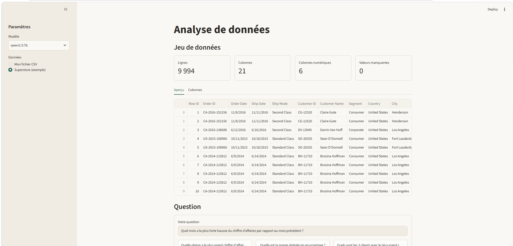

# Data Analyst Agent

Agent IA qui répond à des questions sur un fichier CSV : il écrit du code pandas, l'exécute dans un sous-processus avec timeout, lit le résultat et se corrige en cas d'erreur. Fonctionne 100 % en local avec Ollama, sans clé d'API.

## Interface




L'interface Streamlit permet d'importer un CSV ou d'utiliser un jeu d'exemple, de choisir le modèle, puis d'afficher à chaque étape le code généré et son résultat. Les thèmes clair et sombre sont disponibles dans le menu Settings de Streamlit.

## Fonctionnement

1. L'agent reçoit la question et le schéma du CSV (colonnes, types, aperçu).
2. Le modèle écrit un bloc de code Python.
3. Le code est exécuté dans un sandbox (sous-processus, timeout de 20 s).
4. Le résultat (ou l'erreur) est renvoyé au modèle, qui corrige son code ou donne la réponse finale.
5. Une réponse finale n'est acceptée que si la dernière exécution a réussi.
6. Un contrôle vérifie que la réponse contient la valeur affichée par le code. Sinon, le modèle doit la recopier (2 relances maximum).
7. Une limite de 6 étapes évite les boucles infinies.

### Choix de conception

- **Protocole à base de blocs de code.** Le tool calling natif d'Ollama s'est montré instable avec un modèle 7B quantifié : après un résultat d'outil, le modèle renvoyait des réponses vides. Le modèle écrit donc son code dans un bloc ```` ```python ````, que mon code extrait et exécute. La boucle (raisonner, agir, observer, corriger) est la même, et fonctionne avec n'importe quel modèle.
- **Garde-fou d'exécution.** L'agent refuse toute réponse finale sans exécution réussie. Le sandbox renvoie une ERREUR si le code n'affiche rien, ce qui déclenche l'auto-correction.
- **Contrôle de cohérence code / réponse.** Le modèle écrit parfois un code juste puis une réponse qui le contredit (code affichant « Technology », réponse « Fournitures »). Une consigne dans le prompt ne suffisant pas, la boucle compare la réponse à la sortie du code et redemande la recopie en cas d'écart.
- **Évaluation sur la réponse finale.** Le vérificateur compare la réponse écrite par le modèle à une vérité terrain calculée avec pandas, pas seulement la sortie du code.

### Exemple d'auto-correction

Question : « Quel mois a la plus forte hausse par rapport au précédent ? » Le modèle a corrigé 3 erreurs successives grâce aux messages du sandbox (alias pandas obsolète `'M'`, agrégation sur une colonne texte, `print()` oublié), puis a trouvé la bonne réponse en 4 étapes.

## Évaluation

Dataset Superstore (9 994 lignes, 5 009 commandes distinctes). Les réponses attendues sont calculées avec pandas. Matériel : RTX 3050 portable (6 Go de VRAM), 32 Go de RAM. Les temps incluent le chargement du modèle à la première question.

Trois jeux de questions :

- **Développement (31 questions)** : utilisées pour construire l'agent. Agrégations, dates au format américain, top N, ratios, filtres combinés.
- **Test final (10 questions)** : écrites après le développement et lancées une fois par modèle, sans modifier l'agent entre-temps. Les questions ont été écrites avant le run, mais pas enregistrées dans un commit avant son lancement.
- **v3 (10 questions)** : 7 questions avec le piège « lignes contre commandes distinctes » et 3 contrôles. Enregistrées dans un commit avant la mesure.

### Comparaison des modèles

Mesurée avec la version de base de l'agent (avant les règles de prompt et le contrôle de cohérence).

| Modèle | Dev (31) | Test final (10) | Temps moyen (dev / final) | Étapes moy. (dev / final) |
|---|---|---|---|---|
| qwen2.5:7b | 31/31 (100 %), 30/31 après audit de Q14 | 9/10 | 6,9 s / 6,7 s | 2,3 / 2,2 |
| qwen2.5-coder:7b | 30/31 (97 %) | 8/10 | 7,5 s / 6,4 s | 2,0 / 2,0 |
| qwen2.5:3b-instruct | 19/31 (61 %) | 7/10 | 4,1 s / 6,5 s | 3,4 / 3,5 |

Le prompt et la boucle ont été ajustés en regardant les erreurs du qwen2.5:7b sur le jeu de développement, qui lui est donc favorable. Sur le test final, 9, 8 et 7 sur 10 sont dans la marge d'erreur : les modèles ne peuvent pas être départagés. Ce qui est net : le 3B est moins fiable sur le jeu de développement, et le coder n'a jamais eu besoin de s'auto-corriger (2,0 étapes partout).

### Expérience : confusion lignes / commandes distinctes

Sur 4 échecs des deux modèles 7B, 3 avaient la même cause : le fichier contient plusieurs lignes par commande, et le modèle calculait par ligne alors que la question demandait par commande distincte (F9 pour le qwen2.5:7b, Q8 et F8 pour le coder). Sur v3, le qwen2.5:7b faisait aussi l'erreur (N1, N4), plus un oubli de regroupement (N7).

J'ai testé deux corrections avec le qwen2.5:7b :
- **Règles 6 et 7 dans le prompt** : agréger sur l'identifiant quand la question dit « par commande » ou « distinct », et regrouper avec `groupby` quand elle demande « quel X ».
- **Contrôle de cohérence** (voir ci-dessus).

| Configuration | Dev (31) | v3 (10) | Final (10) | Total |
|---|---|---|---|---|
| Base | 31/31 | 7/10 | 9/10 | 47/51 |
| + règles 6-7 | 27/31 | 9/10 | 10/10 | 46/51 |
| + règles 6-7 + contrôle | 30/31 | 9/10 | 10/10 | **49/51** |

Résultats :
- Les règles corrigent N4, N7 et F9, mais font régresser 4 questions du jeu de développement. Dans 3 cas (Q5, Q8, Q19), le code était juste et la réponse finale le contredisait. Dans le 4e (Q23), la question demande de compter des lignes et le modèle a produit un code faux (pas de filtre sur la région, `nunique` sur une mauvaise colonne).
- Le contrôle de cohérence corrige les 3 premiers cas, au prix d'un peu plus d'étapes (2,5 en moyenne contre 2,2 à 2,3).
- Q23 et N1 échouent toujours : leur code est faux, et le contrôle ne vérifie que la cohérence entre le code et la réponse, pas la justesse du calcul.

**Limite importante** : les règles et le contrôle ont été écrits en observant les échecs de ces trois jeux. Le score de 49/51 est donc optimiste et ne prouve pas une amélioration générale. Un jeu de questions indépendant serait nécessaire pour la confirmer. Les résultats du jeu de développement et du test final avec les règles seules (27/31 et 10/10) ont été écrasés lors des runs suivants : ils proviennent de mes logs de terminal, sans fichier de résultats.

### Autres échecs observés

- **Coder, F6** (sous-catégorie à la remise moyenne la plus élevée) : la réponse finale est le mot « ERREUR » après 2 étapes. Cause non élucidée.
- **Q14** est notée correcte alors que le code compte les lignes par trimestre au lieu de sommer le profit (bonne réponse par coïncidence).
- **qwen2.5:3b** : sur le test final, F1 et F2 utilisent les 6 étapes sans converger. Sur le jeu de développement, 12 échecs sur 31 : calcul incorrect (8), limite d'étapes atteinte (3), résultat partiel (1). Avec l'ancien protocole, sans garde-fou, il réussissait 1/10 : il répondait sans exécuter de code et inventait ses chiffres.

### Progression du qwen2.5:7b sur le jeu de développement

| Version | Dev (Q1-10) | Test (Q11-31) | Cause principale des échecs |
|---|---|---|---|
| Premiers runs (10 questions) | 4/10, puis 9/10, puis 10/10 | n/a | Sandbox muet sans `print()`, vérificateur trop strict, modèle qui contredit le résultat du code (Q6) |
| v1 : boucle de base | 10/10 | 17/21 (16/21 après audit de Q14) | Code juste mais `print()` oublié, réponse finale inventée |
| v2 : garde-fou d'exécution | 10/10 | 21/21 (20/21 après audit de Q14) | Aucun échec restant |

Les premières corrections portaient sur mon infrastructure (sandbox, vérificateur, prompt), pas sur le modèle.

## Limites connues

- **Le contrôle ne vérifie pas la justesse du calcul.** Un code qui s'exécute mais répond à une autre question que celle posée n'est pas détecté (Q23, N1).
- **Évaluation optimiste** : les corrections ont été conçues en observant les jeux sur lesquels elles sont mesurées. Pas de jeu indépendant pour les confirmer.
- **Petits échantillons** : 10 questions par jeu, un seul run par modèle. Les résultats sont indicatifs.
- **Vérificateur imparfait** : il ignore le signe des nombres, valide si le mot attendu apparaît n'importe où dans la réponse, et peut valider un petit nombre présent par hasard.
- **Dates fragiles** : le modèle écrit souvent `pd.to_datetime` sans préciser le format, ou utilise `str.contains('2016')`. Cela fonctionne ici mais n'est pas robuste.
- **Sandbox** : il protège contre les plantages et les boucles infinies, mais ce n'est pas une isolation de sécurité (le code peut lire des fichiers). Docker serait nécessaire en production.
- **Un seul dataset.**

## Prochaines étapes

- Jeu de questions indépendant pour confirmer (ou infirmer) les règles et le contrôle
- Exécution du code dans Docker, démo en ligne

## Lancer le projet

```bash
conda create -n agent-data python=3.12
conda activate agent-data
pip install -r requirements.txt
ollama pull qwen2.5:7b
```

Les données Superstore ne sont pas incluses : télécharger `Sample - Superstore.csv` sur Kaggle, le placer dans `data/`, puis le convertir en UTF-8 :

```bash
python -c "import pandas as pd; pd.read_csv('data/Sample - Superstore.csv', encoding='latin-1').to_csv('data/superstore.csv', index=False)"
```

### Application

Ollama doit être lancé, puis :

```bash
streamlit run app.py
```

### Évaluation

```bash
python evaluate.py qwen2.5:7b          # développement (31 questions)
python evaluate.py qwen2.5:7b final    # test final (10 questions)
python evaluate.py qwen2.5:7b v3       # v3 (10 questions)
```

Les résultats sont enregistrés dans `eval/`.