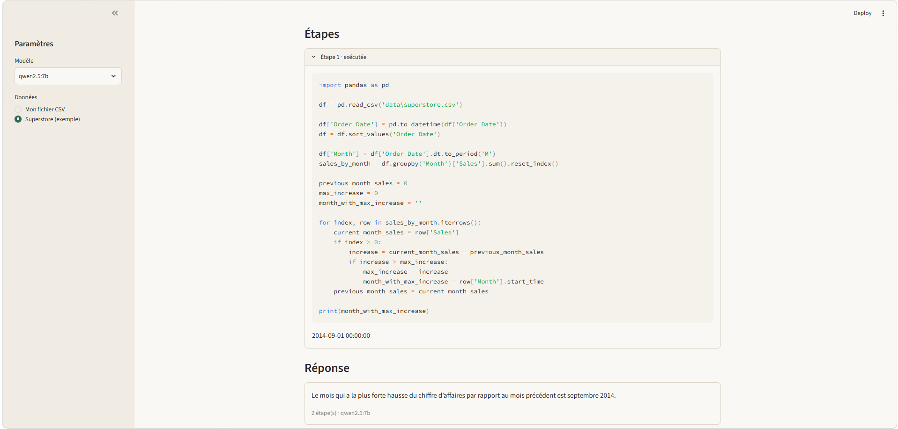

# Data Analyst Agent

Agent IA qui répond à des questions sur un fichier CSV : il écrit du code pandas, l'exécute dans un sous-processus avec timeout, lit le résultat et se corrige en cas d'erreur. Fonctionne 100 % en local avec Ollama, sans clé d'API.

## Interface




L'interface Streamlit permet d'importer un CSV ou d'utiliser un jeu d'exemple, de choisir le modèle, puis d'afficher à chaque étape le code généré et son résultat. Les thèmes clair et sombre sont disponibles dans le menu Settings de Streamlit.

## Fonctionnement

1. L'agent reçoit la question et le schéma du CSV (colonnes, types, aperçu).
2. Le modèle écrit un bloc de code Python.
3. Le code est exécuté dans un sandbox (sous-processus, timeout de 20 s).
4. Le résultat (ou l'erreur) est renvoyé au modèle, qui corrige son code ou donne la réponse finale.
5. Une réponse finale n'est acceptée que si la dernière exécution a réussi.
6. Une limite de 6 étapes évite les boucles infinies.

### Choix de conception

- **Protocole à base de blocs de code.** Le tool calling natif d'Ollama s'est montré instable avec un modèle 7B quantifié : après un résultat d'outil, le modèle renvoyait des réponses vides. Le modèle écrit donc son code dans un bloc ```` ```python ````, que mon code extrait et exécute. La boucle (raisonner, agir, observer, corriger) est la même, et fonctionne avec n'importe quel modèle.
- **Garde-fou d'exécution.** L'agent refuse toute réponse finale sans exécution réussie. Le sandbox renvoie une ERREUR si le code n'affiche rien, ce qui déclenche l'auto-correction.
- **Évaluation sur la réponse finale.** Le vérificateur compare la réponse écrite par le modèle à une vérité terrain calculée avec pandas, pas seulement la sortie du code.

### Exemple d'auto-correction

Question : « Quel mois a la plus forte hausse par rapport au précédent ? » Le modèle a corrigé 3 erreurs successives grâce aux messages du sandbox (alias pandas obsolète `'M'`, agrégation sur une colonne texte, `print()` oublié), puis a trouvé la bonne réponse en 4 étapes.

## Évaluation

Dataset Superstore (9 994 lignes, 5 009 commandes distinctes). Les réponses attendues sont calculées avec pandas. Matériel : RTX 3050 portable (6 Go de VRAM), 32 Go de RAM. Les temps incluent le chargement du modèle à la première question.

Deux jeux de questions :

- **Jeu de développement (31 questions)** : utilisées pour construire et corriger l'agent. Agrégations, dates au format américain, top N, ratios, filtres combinés.
- **Test final (10 questions inédites)** : écrites après la fin du développement et lancées une seule fois par modèle, sans modifier l'agent entre-temps. Pièges ciblés : commandes distinctes contre lignes, dates par mois, seuils par client.

### Résultats

| Modèle | Dev (31 questions) | Test final (10 questions) | Temps moyen (dev / final) | Étapes moy. (dev / final) |
|---|---|---|---|---|
| qwen2.5:7b | 31/31 (100 %), 30/31 après audit de Q14 | 9/10 (90 %) | 6,9 s / 6,7 s | 2,3 / 2,2 |
| qwen2.5-coder:7b | 30/31 (97 %) | 8/10 (80 %) | 7,5 s / 6,4 s | 2,0 / 2,0 |
| qwen2.5:3b-instruct | 19/31 (61 %) | 7/10 (70 %) | 4,1 s / 6,5 s | 3,4 / 3,5 |

**Lecture prudente.** Le prompt et la boucle ont été ajustés en regardant les erreurs du qwen2.5:7b sur le jeu de développement, qui lui est donc favorable. Sur le test final, l'échantillon est trop petit (10 questions) pour classer les modèles : 9, 8 et 7 sur 10 sont dans la marge d'erreur. Ce qui est net : le 3B est nettement moins fiable sur le jeu de développement, et le coder n'a jamais eu besoin de s'auto-corriger (2,0 étapes partout), alors que les autres modèles oublient parfois `print()`.

### Principale cause d'échec : lignes contre commandes distinctes

Sur les 4 échecs des deux modèles 7B, 3 viennent de la même confusion. Le fichier contient plusieurs lignes par commande, et le modèle calcule par ligne alors que la question demande par commande distincte (`Order ID`).

| Modèle | Question | Attendu | Réponse | Calcul réalisé |
|---|---|---|---|---|
| qwen2.5:7b | F9 : clients avec au moins 10 commandes distinctes | 88 | 523 | Nombre de lignes par client (`len(x) >= 10`) |
| qwen2.5-coder:7b | Q8 : profit moyen par commande | 57 | 29 | Profit moyen par ligne |
| qwen2.5-coder:7b | F8 : chiffre d'affaires moyen par commande | 458,6 | 229,9 | Chiffre d'affaires moyen par ligne |

Le code s'exécute sans erreur dans les trois cas, donc le garde-fou ne détecte rien, et les réponses reprennent le mot « commande » de la question comme si elles y répondaient. Aucun des deux 7B ne commet l'erreur sur les mêmes questions, ce qui indique une fragilité du protocole plus qu'un défaut d'un modèle en particulier.

Autre échec du coder : **F6** (sous-catégorie avec la remise moyenne la plus élevée, attendu Binders). Sa réponse finale est le mot « ERREUR » après 2 étapes. Cause non élucidée.

### Échecs du qwen2.5:3b

Sur le test final : F1 et F2 utilisent les 6 étapes autorisées sans converger, et F9 échoue après 4 étapes. Sur le jeu de développement (12 échecs sur 31) :

- **Calcul incorrect (8)** : mauvaise agrégation ou mauvais filtre. Exemples : Q4 renvoie un montant au lieu d'une région, Q28 renvoie « Second Class » au lieu de « Standard Class ». Q15 et Q22 renvoient une fraction (0,2) au lieu d'un pourcentage.
- **Limite d'étapes atteinte (3)** : Q9, Q14, Q21.
- **Résultat partiel (1)** : Q16, deux clients sur trois corrects.

Avec l'ancien protocole, sans garde-fou et sur les 10 premières questions, le 3B réussissait 1/10 : il répondait sans exécuter de code et inventait ses chiffres. Le garde-fou le rend utilisable, mais il ne garantit pas la justesse du calcul.

### Progression du qwen2.5:7b sur le jeu de développement

| Version | Dev (Q1-10) | Test (Q11-31) | Cause principale des échecs |
|---|---|---|---|
| Premiers runs (10 questions) | 4/10, puis 9/10, puis 10/10 | n/a | Sandbox muet sans `print()`, vérificateur trop strict, modèle qui contredit le résultat du code (Q6) |
| v1 : boucle de base | 10/10 | 17/21 (16/21 après audit de Q14) | Code juste mais `print()` oublié, réponse finale inventée |
| v2 : garde-fou d'exécution | 10/10 | 21/21 (20/21 après audit de Q14) | Aucun échec restant |

Les premières corrections portaient sur mon infrastructure (sandbox, vérificateur, prompt), pas sur le modèle. À la v1, les 4 échecs du jeu de test avaient la même cause : le modèle oubliait `print()`, le sandbox le signalait, mais la boucle acceptait quand même une réponse finale sans résultat valide. La v2 exige une exécution réussie avant toute réponse, et le modèle se corrige alors en 4 étapes.

## Limites connues

- **Le garde-fou vérifie l'exécution, pas le sens.** Un code qui tourne mais répond à une autre question que celle posée n'est pas détecté. C'est la cause de 3 des 4 échecs des modèles 7B.
- **Test final de 10 questions** : trop petit pour départager les modèles. Les questions ont été écrites avant le run, mais n'ont pas été enregistrées dans un commit avant son lancement.
- **Q14 est un faux positif** : elle est notée correcte, mais le code compte les lignes par trimestre au lieu de sommer le profit (bonne réponse par coïncidence).
- **Vérificateur imparfait** : il ignore le signe des nombres et peut valider un petit nombre présent par hasard dans la réponse.
- **Dates fragiles** : le modèle écrit souvent `pd.to_datetime` sans préciser le format, ou utilise `str.contains('2016')`. Cela fonctionne ici mais n'est pas robuste.
- **Sandbox** : il protège contre les plantages et les boucles infinies, mais ce n'est pas une isolation de sécurité (le code peut lire des fichiers). Docker serait nécessaire en production.
- **Un seul dataset, un seul run par modèle** : les résultats sont indicatifs.

## Prochaines étapes

- Vérification de cohérence entre la question et le code (par exemple « par commande distincte » doit entraîner un `nunique` sur `Order ID`), à mesurer sur un nouveau jeu de questions
- Exécution du code dans Docker, démo en ligne

## Lancer le projet

```bash
conda create -n agent-data python=3.12
conda activate agent-data
pip install -r requirements.txt
ollama pull qwen2.5:7b
```

Les données Superstore ne sont pas incluses : télécharger `Sample - Superstore.csv` sur Kaggle, le placer dans `data/`, puis le convertir en UTF-8 :

```bash
python -c "import pandas as pd; pd.read_csv('data/Sample - Superstore.csv', encoding='latin-1').to_csv('data/superstore.csv', index=False)"
```

### Application

Ollama doit être lancé, puis :

```bash
streamlit run app.py
```

### Évaluation

```bash
python evaluate.py qwen2.5:7b          # jeu de développement (31 questions)
python evaluate.py qwen2.5:7b final    # test final (10 questions)
```

Les résultats sont enregistrés dans `eval/`.